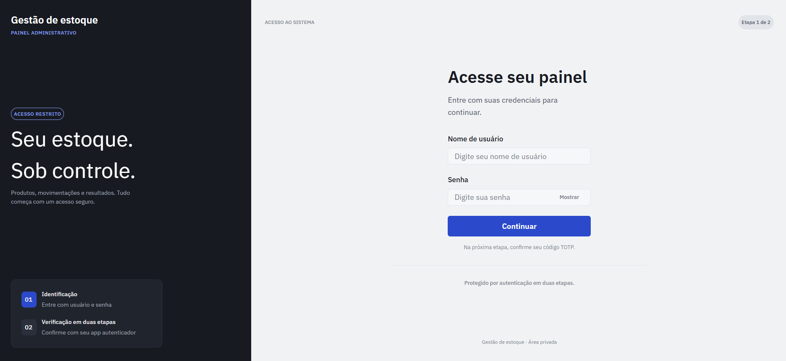
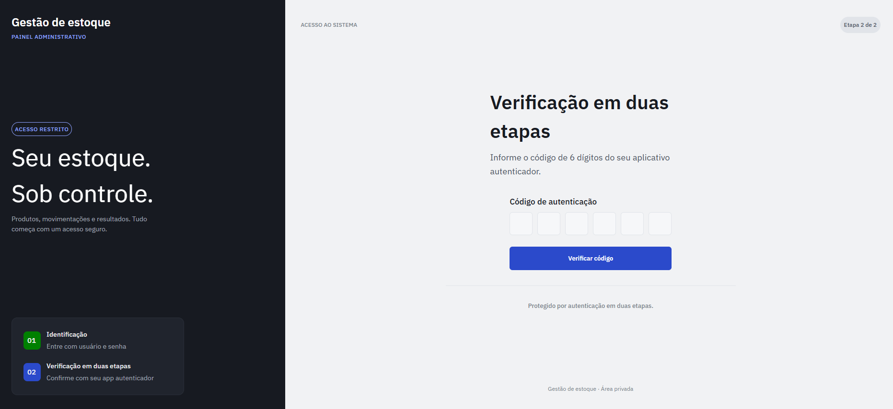
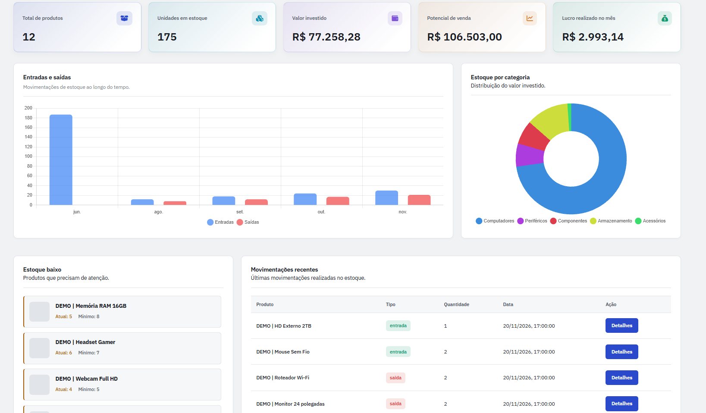
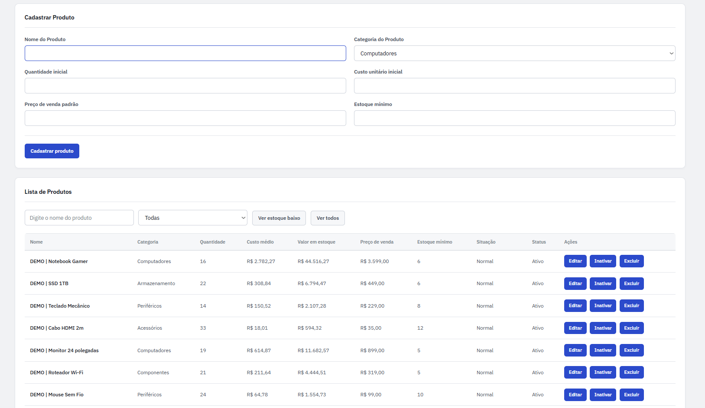
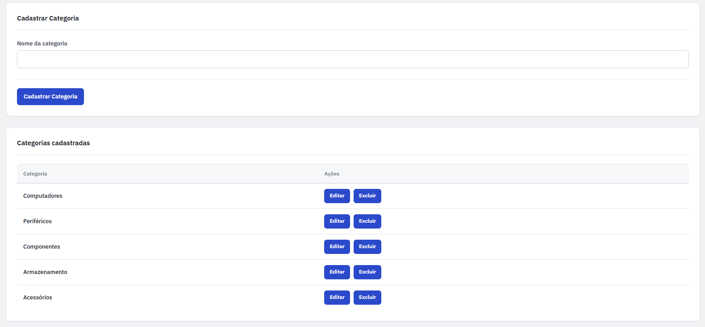
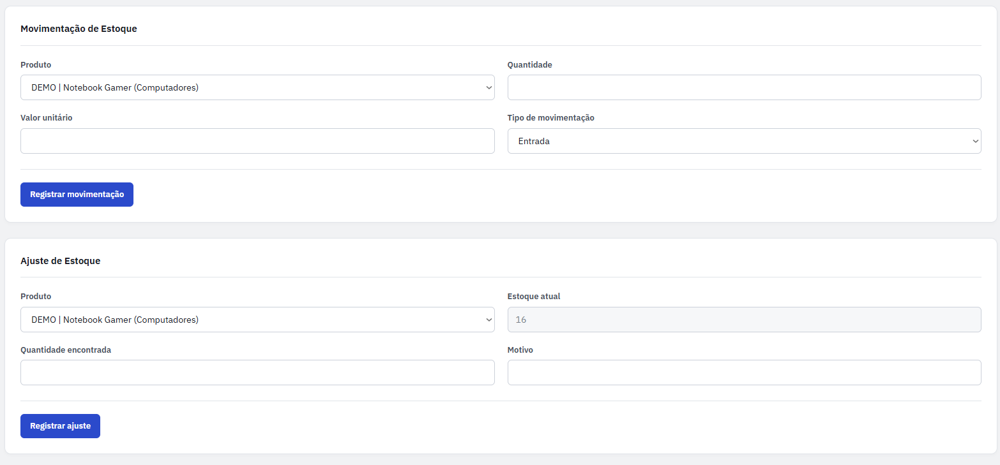
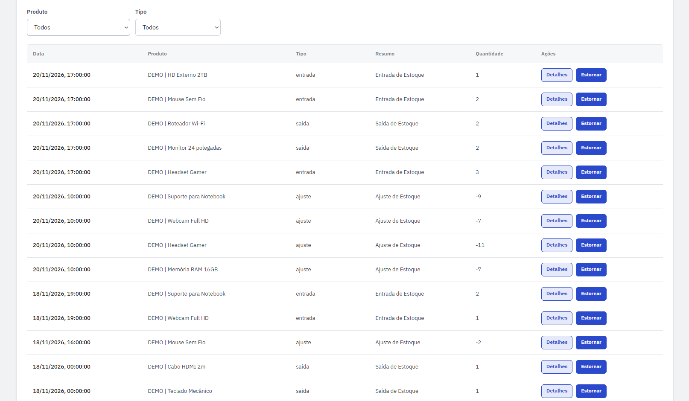

# Gerenciador de Estoque

## Sobre o projeto

A ideia deste projeto surgiu da minha necessidade de organizar os itens que compro e vendo em jogos Web3, que possuem valor financeiro e representam um investimento.

Eu precisava controlar meu estoque, registrar compras e vendas, acompanhar os custos e entender os resultados das negociações. Para resolver isso, desenvolvi o Gerenciador de Estoque, uma aplicação que centraliza o cadastro de itens, as movimentações e o histórico, além de apresentar informações financeiras por meio de um dashboard.

Embora tenha surgido de uma necessidade pessoal, o sistema foi desenvolvido para também atender a outros negócios que precisam controlar produtos e movimentações de estoque.

## Funcionalidades

- **Dashboard:** apresenta informações sobre o estoque, valores investidos, potencial de vendas, lucro realizado e movimentações.
- **Produtos:** permite cadastrar, editar, ativar e desativar produtos.
- **Categorias:** permite organizar os produtos em categorias.
- **Movimentações:** registra entradas e saídas de estoque.
- **Ajustes de estoque:** permite corrigir quantidades, registrando o motivo de cada ajuste.
- **Histórico:** reúne as movimentações realizadas e permite consultar seus detalhes e realizar estornos quando as regras do sistema permitem.
- **Autenticação e segurança:** acesso administrativo protegido por usuário e senha, seguido de verificação em duas etapas com código TOTP. O sistema utiliza sessões armazenadas no PostgreSQL, controle de tentativas de autenticação e encerramento de sessão.


## Capturas de tela

### Login


### Verificação em duas etapas


### Dashboard


### Produtos


### Categorias


### Movimentações


### Histórico


## Tecnologias utilizadas

**Frontend**
- HTML5
- CSS3
- JavaScript
- Chart.js
- Font Awesome

**Backend**
- Node.js
- Express
- JavaScript (ES Modules)
- PostgreSQL
- pg
- dotenv

**Autenticação e segurança**
- argon2
- express-session
- connect-pg-simple
- otplib
- qrcode
- express-rate-limit

## Organização do projeto

O backend foi organizado em camadas para separar as responsabilidades de cada parte da aplicação:

- **Routes:** definem os endpoints e encaminham as requisições.
- **Controllers:** recebem as requisições e organizam as respostas.
- **Services:** concentram as regras de negócio e coordenam as operações.
- **Repositories:** cuidam das consultas e operações no banco de dados.
- **Middlewares:** executam validações, verificam autenticação, limitam tentativas e tratam erros das requisições.
- **Database:** concentra a conexão e a estrutura do banco de dados.
- **Utils:** reúne funções auxiliares utilizadas pelo backend.

Essa organização facilita a manutenção e deixa mais claro onde cada responsabilidade deve ser tratada.

## Estrutura de pastas

```text
gerenciador-de-estoque/
├── backend/
│   ├── controllers/
│   │   ├── ajustes-estoque.controller.js
│   │   ├── auth.controller.js
│   │   ├── categorias.controller.js
│   │   ├── movimentacoes.controller.js
│   │   └── produtos.controller.js
│   ├── database/
│   │   ├── migrations/
│   │   │   ├── 001_criacao_tabela_administradores.sql
│   │   │   └── 002_criacao_tabela_sessoes.sql
│   │   └── schema.sql
│   ├── middlewares/
│   │   ├── rate-limit-login.middleware.js
│   │   ├── rate-limit-totp.middleware.js
│   │   ├── tratar-erros-json.js
│   │   ├── validar-corpo-requisicao.middleware.js
│   │   └── verificar-autenticacao.middleware.js
│   ├── repositories/
│   │   ├── administradores.repository.js
│   │   ├── categorias.repository.js
│   │   ├── movimentacoes.repository.js
│   │   └── produtos.repository.js
│   ├── routes/
│   │   ├── ajustes-estoque.routes.js
│   │   ├── auth.routes.js
│   │   ├── categorias.routes.js
│   │   ├── movimentacoes.routes.js
│   │   └── produtos.routes.js
│   ├── scripts/
│   │   └── criar-administrador-inicial.js
│   ├── services/
│   │   ├── ajustes-estoque.service.js
│   │   ├── auth.service.js
│   │   ├── categorias.service.js
│   │   ├── movimentacoes.service.js
│   │   └── produtos.service.js
│   ├── utils/
│   │   └── transacoes.js
│   ├── .env.example
│   ├── db.js
│   ├── package-lock.json
│   ├── package.json
│   └── server.js
│
├── frontend/
│   ├── css/
│   │   └── style.css
│   ├── js/
│   │   ├── api.js
│   │   ├── auth.js
│   │   ├── categorias.js
│   │   ├── dashboard.js
│   │   ├── historico.js
│   │   ├── movimentacoes.js
│   │   ├── produtos.js
│   │   ├── script.js
│   │   └── utilitarios.js
│   └── index.html
│
├── docs/
│   ├── api.md
│   ├── arquitetura-backend.md
│   ├── autenticacao.md
│   └── regras-de-negocio.md
│
├── screenshots/
│   ├── categorias.png
│   ├── dashboard.png
│   ├── historico.png
│   ├── login.png
│   ├── movimentacoes.png
│   ├── produtos.png
│   └── totp.png
│
├── .gitignore
└── README.md
```

## Banco de dados

O projeto utiliza PostgreSQL para armazenar os dados do estoque e da autenticação.

As tabelas principais do gerenciamento de estoque são:

- **categorias:** armazena as categorias dos produtos.
- **produtos:** armazena os produtos, suas quantidades, custos, preços e situação.
- **movimentacoes:** registra entradas, saídas, ajustes e estornos do estoque.

A autenticação utiliza duas tabelas adicionais:

- **administradores:** armazena os dados do administrador, incluindo o hash da senha e o segredo TOTP criptografado.
- **sessoes:** armazena as sessões de autenticação.

Os scripts SQL estão organizados em:

- `backend/database/schema.sql`: criação das tabelas do estoque.
- `backend/database/migrations/`: scripts de criação das tabelas de autenticação.

## Como executar o projeto

### Pré-requisitos

- Node.js 18 ou superior
- PostgreSQL

### 1. Configurar o banco de dados

Crie um banco de dados no PostgreSQL e execute os scripts SQL na seguinte ordem:

1. `backend/database/schema.sql`
2. `backend/database/migrations/001_criacao_tabela_administradores.sql`
3. `backend/database/migrations/002_criacao_tabela_sessoes.sql`

### 2. Instalar as dependências

Abra o terminal na pasta `backend` e execute:

```bash
npm install
```

### 3. Configurar as variáveis de ambiente

Crie um arquivo `.env` dentro da pasta `backend`, utilizando o `.env.example` como referência.

Preencha as informações de conexão com o banco de dados e configure as variáveis de autenticação.

Para gerar os valores de segurança, execute os comandos abaixo no terminal:

**SESSION_SECRET**
```bash
node -e "console.log(require('crypto').randomBytes(64).toString('hex'))"
```

**TOTP_ENCRYPTION_KEY**
```bash
node -e "console.log(require('crypto').randomBytes(32).toString('base64'))"
```

Copie os valores gerados para suas respectivas variáveis no `.env`.

Não compartilhe esses valores nem os publique no GitHub. A chave `TOTP_ENCRYPTION_KEY` deve ser mantida em Base64.

### 4. Criar o administrador inicial

Na pasta `backend`, execute:

```bash
node scripts/criar-administrador-inicial.js
```

Durante a execução, o script solicitará os dados necessários para cadastrar o administrador inicial. Informe o nome de usuário e a senha solicitados e siga as instruções exibidas no terminal.

Guarde essas credenciais com segurança, pois elas serão utilizadas para acessar o sistema.

### 5. Iniciar a aplicação

Na pasta `backend`, execute:

```bash
npm start
```

Após iniciar o servidor, acesse a aplicação pelo navegador:

http://localhost:3000

## Documentação complementar

Para conhecer melhor o funcionamento do sistema, consulte:

- [Arquitetura do backend](docs/arquitetura-backend.md)
- [Regras de negócio](docs/regras-de-negocio.md)
- [Documentação da API](docs/api.md)
- [Documentação da autenticação](docs/autenticacao.md)

## Status do projeto

O projeto está em desenvolvimento. Novas funcionalidades, melhorias e ajustes ainda estão sendo implementados conforme as necessidades identificadas durante o uso e o processo de desenvolvimento.